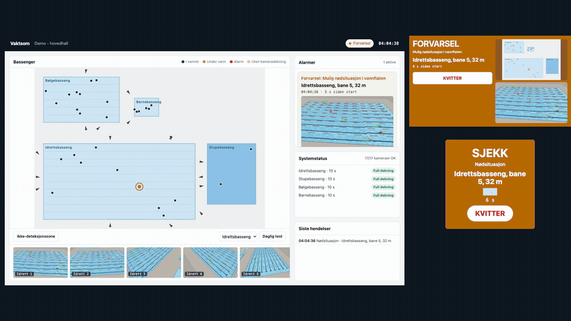
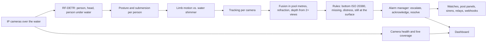
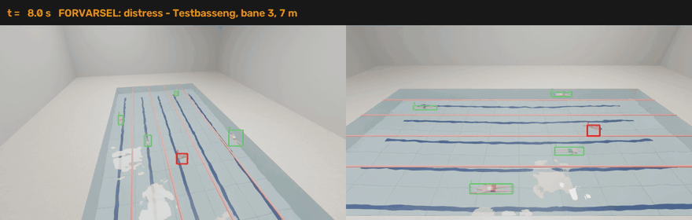

# Vaktsom

Drowning detection and lifeguard alerting for public swimming pools. Cameras above the water follow
every bather in pool coordinates, and the system raises an alarm when a person lies still on the
bottom, when a person who went under is no longer seen, and when a person at the surface shows the
signs of drowning before going under. Alarms reach the lifeguards on their watches, on wired post
panels and on network sirens, with the basin and the position in words. All video is processed on
site.

<p align="center"></p>
<sub>A simulated opening day in a hall with four basins. A swimmer in lane 5 struggles and gets a
surface warning, the lifeguard acknowledges it on the watch, the swimmer sinks and the bottom alarm
follows. Dashboard on the left, post panel and watch on the right.</sub>



**Highlights**

- **Every simulated drowning found, with no false alarms.** In simulation of the NS-EN ISO 20380 tests, a
  manikin on the bottom at 50 positions in each of four basins raised the alarm within the
  standard's tolerance in all 200 trials, with a median position error of 2 to 4 cm. Twelve hours
  of busy bathing per basin gave no false alarm, and all 160 simulated drownings raised the alarm,
  95 % of them within 10.7 s of the body reaching the bottom.
- **The trained detector on photorealistic video.** On eight rendered two-camera videos the full
  chain (detector, tracking, rules, alarms) passed all eight: every drowning alarmed 7.9 to 9.1 s
  after the body reached the bottom, within 8 cm of the true position, every active drowning was
  warned before the person went under, and a breath-hold dive and normal swimming raised nothing.
- **Bodies located in 3D through the water surface.** Rays from calibrated cameras refract at the
  surface (Snell), so a body on the bottom of a 5 m diving pit is placed where it is, and two or
  more views give its depth, which tells a body on the bottom from a swimmer above it.
- **A detector trained for the view from the ceiling.** About 4,800 Blender renders of pool halls
  from ceiling cameras, with labels from a second mask render through the same water, lift the
  detection of fully submerged bodies from 52 % to 93 %, and to 94.5 % with the large model.
- **Built to run a pool.** Two alarm paths per basin with one of them wired, escalation, live
  coverage maps, wave-machine and movable-floor modes, roles and device tokens, encrypted alarm
  clips that are deleted beyond recovery, and a monthly report against the standard's limits.

## Quickstart

```bash
uv venv --python 3.11 .venv && source .venv/bin/activate
uv pip install -e ".[dev,onnx]"
vaktsom serve --config configs/demo.yaml --sim demo_story --port 8096 --no-auth   # simulated cameras
```

Open `localhost:8096`. The other pages are `/panel?basins=idrett,stup` (lifeguard post), `/watch`,
`/alarms` (alarm history with clips), `/report` (monthly report) and `/api/docs` (API). With real
cameras and the exported models:

```bash
vaktsom serve --config configs/site.yaml --model det.onnx --attributes attr.onnx
```

## Results

All results come from simulation and rendered video. In a real pool, performance is documented with
the detection and non-detection tests of NS-EN ISO 20380 at commissioning.

### Full chain on photorealistic video

Eight videos rendered in Blender from two calibrated ceiling cameras, 30 s each: four active and two
passive drownings, a breath-hold dive and normal swimming, in 1.6, 2 and 3 m of water, with other
swimmers in the lanes. The exported detector and attribute model run on the frames, and tracking,
rules and alarms run exactly as on site.

| Detector | Videos passed | Bottom to alarm | Warned before going under (active) | Position error |
|---|---|---|---|---|
| **RF-DETR-L, 704 px** | **8/8** | 7.9-9.1 s | 4/4, after 6.9 s of struggle | ≤ 0.08 m |
| RF-DETR-M | 8/8 | 7.9-9.1 s | 4/4, after 6.9-7.1 s | ≤ 0.13 m |

<p align="center"></p>
<sub>The trained detector on a rendered 3 m pool. The struggling swimmer gets a warning before going
under, and the bottom alarm comes 9.1 s after the body reaches the bottom, 6 cm from its true
position.</sub>

The set-off time is a fixed 10 s, counted from the moment the body comes to rest near the bottom,
so the last centimetres of sinking count towards it.

### The system in simulation

The simulator moves bathers through a hall with four basins (a 50 m sports pool with a movable
floor, a 5 m diving pit, a wave pool and a 0.3 m children's pool) and turns them into detections
with a detector error model: misses, false detections, depth-dependent recall, glare, occlusion and
wrong submersion calls. The numbers measure tracking, fusion, rules and alarm handling.

ISO 20380 detection test: a manikin on the bottom at 50 positions per basin, with other bathers
around. A trial passes when the alarm comes within 2 s of the set-off time and within 2 m of the
manikin.

| Basin | Alarm within tolerance | Median position error | Largest position error |
|---|---|---|---|
| Sports pool | 100 % | 2 cm | 4 cm |
| Wave pool | 100 % | 3 cm | 7 cm |
| Diving pit, 5 m | 100 % | 4 cm | 17 cm |
| Children's pool, 0.3 m | 100 % | 3 cm | 42 cm |

The latest alarm of all 200 trials came 0.9 s after the set-off time. In the non-detection test, a
person standing still in shallow water for 40 s raised no alarm.

Twelve hours of bathing per basin, with swimmers, divers fetching objects, floaters, people standing
in the water and a breath-hold game on the bottom every ten minutes. The standard allows on average
at most 5 false alarms per basin per day.

| Basin | Bathers | False alarms per day | Surface warnings per day |
|---|---|---|---|
| Sports pool | 72 | 0 | 2 |
| Wave pool | 27 | 0 | 1 |
| Diving pit | 23 | 0 | 2 |
| Children's pool | 13 | 0 | 0 |

Drownings, 26 active and 14 passive per basin:

| Basin | Detected | Median bottom to alarm (active / passive) | 95 % alarmed within | Warned before going under (active) |
|---|---|---|---|---|
| Sports pool | 40/40 | 7.7 / 7.7 s | 8.8 s | 54 % |
| Wave pool | 40/40 | 9.0 / 6.5 s | 10.7 s | 15 % |
| Diving pit | 40/40 | 8.2 / 8.2 s | 9.1 s | 100 % |
| Children's pool | 40/40 | 9.9 / 6.3 s | 10.3 s | 0 % (a person can stand) |

Surface warnings are given only where an adult cannot stand (`standing_depth_m`, 1.35 m by
default); the bottom rule works everywhere. The warning threshold of 0.80 comes from a sweep over
18 hours of bathing and 90 drownings: at 0.75 the simulation gave 6 to 14 false warnings per day, at
0.80 none, with the same share of drownings warned early, and on the rendered videos 0.80 warned
all four active drownings.

### Detector

RF-DETR (Apache 2.0) trained on three kinds of data: 1,950 real pool photos with people from Open
Images and 126 from COCO, 22,247 composites of people under and on the water of real pool photos,
and about 4,800 renders from ceiling cameras. Test sets: 98 real photos (483 people) and 500
held-out renders (2,258 people, 586 fully submerged).

| Training data | Model | Photos AP50 | Renders AP50 | Renders AP50:95 | Submerged bodies found | Submersion right |
|---|---|---|---|---|---|---|
| Real photos | M | 0.657 | 0.777 | 0.459 | 52 % | 75 % |
| Real photos + composites | M | 0.528 | 0.532 | 0.321 | 32 % | 68 % |
| Real photos + composites + renders | M | 0.566 | 0.944 | 0.721 | 93 % | 94 % |
| Real photos + renders | M | 0.613 | 0.950 | 0.747 | 93 % | 95 % |
| **Real photos + renders** | **L, 704 px** | 0.593 | **0.960** | **0.784** | **94.5 %** | **95.7 %** |

- **Renders from the ceiling matter most.** They teach the view the system works from, and the
  composites are left out of the detector. The composites still train the attribute model, which
  reads posture (97.0 %) and submersion (98.3 %) from each person's crop.
- **Even at every depth.** The medium model finds 91 % of submerged bodies down to 1 m, 95 % at
  1-2 m, 90 % at 2-3 m and 95 % at 3-6 m; the large model finds 94.2 % of bodies on the bottom.
- **Sized for one GPU per hall.** With TensorRT FP16 at batch 16 on an A100, the medium model runs
  at 1,449 frames/s and the large one at 961, about twice their PyTorch speed. The system needs at
  least 5 frames/s per camera, about 190 frames/s for a hall with 38 cameras.

## How it works

- **Bottom rule (ISO 20380).** Fully submerged, still, on or near the bottom for the basin's fixed
  set-off time (10 s by default, at most 15 s). The clock starts at the true onset. The still time
  belongs to the spot, so when the trackers swap identities over a body, the new identity takes
  over the running time instead of starting again.
- **Missing rule.** A person last seen under water whom no camera sees any more, after the same
  time, at the last known position. Divers who come up elsewhere are re-acquired.
- **Distress and still at the surface.** Pre-alarms from the instinctive drowning response
  (upright in deep water, no forward progress, the head sinking and resurfacing) and from a body
  lying still at the surface where nobody can stand, upgraded when ignored and re-armed when an
  acknowledged warning turns into a body under water.
- **Fusion.** Each camera's tracks become rays in pool metres. Views are linked to a person only at
  the depths that person can be at, a view that stays more than 1.5 m from the person's other
  views is released, and rays that do not meet give no depth. A person up to 0.5 m outside a
  basin's outline still belongs to the basin, so a body by the wall is never dropped.
- **Coverage.** Each camera reports only where it sees well enough (pixels per metre, viewing
  angle). Frozen, dark, blurred or fogged cameras and glare are detected, and a 0.5 m coverage map
  shows where detection is reduced at any moment.
- **Operating modes.** While the wave machine runs, the wave pool shows reduced detection and
  surface warnings pause; the bottom and missing rules keep running. The current height of a
  movable floor decides what counts as the bottom, and while it is unknown every still body under
  water in that region counts.
- **Failures are visible.** If detection stops, every panel and watch shows a system fault within
  5 s, and a panel that loses the server says so across the whole screen.

### Access and privacy

```bash
vaktsom user add anne --role leder --config configs/site.yaml       # badevakt, leder, admin, leverandor
vaktsom device add "Post idrett" --kind panel --url https://vaktsom.local --config configs/site.yaml
vaktsom device revoke "Post idrett" --config configs/site.yaml
```

- **Roles.** `badevakt` (lifeguard) acknowledges and resolves alarms, sets non-detection zones and
  runs the daily test; `leder` (manager) also views and exports clips, closes basins and reads the
  logs; `admin` manages users and devices; `leverandor` (supplier service) reads state, statistics
  and logs, never images or clips.
- **Devices.** `device add` prints a link with `#token=...`; the panel or watch opens it once and
  trades the token for a session cookie. Revoking the token ends the device's live feeds within
  5 s.
- **Sessions.** HMAC-signed, HttpOnly, SameSite=Strict cookies. Passwords are scrypt hashes, and
  five failures in five minutes lock the name. Logins, failures, device changes and every clip view
  or export go to the operational log. `--no-auth` is refused without `--sim`.
- **Clips.** No continuous recording. A few seconds around each alarm are stored, encrypted with
  AES-256-GCM under a key for that clip only. Deleting the key destroys the clip in every copy and
  backup; clips are deleted after 7 days and logs after 30. Privacy masks are applied before
  anything is stored, and there is no face recognition.

### Report

`vaktsom report --month 2026-11` or `/report`: alarms and outcomes per basin, false alarms per basin
per day against the ISO 20380 limit, acknowledgement times, daily tests, hours of reduced coverage
and camera downtime, from the health log of every state change.

## Configuration

`configs/*.yaml` describes the site: basins (outline, depth regions, movable floor, set-off time),
cameras (calibration `K, R, t` from surveyed points or a design pose, water mask, privacy masks),
outputs (panel, wearable, siren, Modbus coil, webhook, log; the validator demands two alarm paths
per basin, one of them wired), escalation, retention and rules. `configs/site-template.yaml` is a
starting point for a real site.

Camera layout for a new site: `python -m vaktsom.design.coverage --config site.yaml` places the
fewest cameras so that every 0.5 m cell is seen from two brackets at ≥ 40 px/m and ≤ 65 degrees.

## Evaluate

```bash
vaktsom eval all --config configs/demo.yaml --out runs/eval                # ISO tests, false alarms, drownings
python ml/e2e_set.py --videos data/video_set --model det.onnx --attributes attr.onnx --out runs/e2e/summary.json
python ml/field_test.py --video swim.mp4 --pick --pool 25 12.5            # real footage: click 4+ pool points
python ml/field_test.py --video swim.mp4 --pool 25 12.5 --model det.onnx --out runs/field/swim
pytest -q
```

## Training

The data, renders and models are built on a Slurm GPU cluster; `slurm/cluster.toml` holds every
job and `python slurm/generate.py <job> --submit` renders and submits it (the account goes in a
git-ignored `slurm/cluster.local.toml`).

| Step | Script | Job |
| --- | --- | --- |
| Real pool photos with people (Open Images V7, COCO captions) | `ml/data/openimages_pool.py`, `ml/data/coco_pool.py` | `scripts/download_data.sh` |
| Composites under and on the water | `ml/synth/composite.py` | `composites` |
| Ceiling-camera renders and test videos (Blender, Cycles) | `ml/render/pool_scene.py`, `ml/render/pool_video.py` | `render`, `video-set` |
| Detector | `ml/train_detector.py`, `ml/eval_detector.py`, `ml/export_detector.py` | `train-det`, `eval-det`, `export-det` |
| Posture and submersion per crop | `ml/train_attributes.py` | `train-attr` |
| Throughput | `ml/bench_detector.py`, `ml/bench_trt.py` | `bench-det`, `bench-trt` |
| Full chain on video, warning threshold, system evaluation | `ml/e2e_set.py`, `ml/sweep_distress.py`, `vaktsom eval` | `e2e-set`, `sweep-distress`, `eval-sim` |

Licences: no AGPL code. Images: Open Images CC BY 2.0, COCO (Flickr licences); the renders and the
humanoids in them are generated here.

## Deployment

Two GPU servers (one NVIDIA L4 each, active and standby) on UPS, PoE switches in a closed VLAN,
cameras IP66 or better, network strobe sirens, PoE post panels and waterproof watches on Wi-Fi. No
inbound internet; an outbound VPN carries health telemetry and updates. The web clients use HTTPS
with a certificate from the site's own CA, served by uvicorn directly or behind the site's reverse
proxy.

## License

MIT
